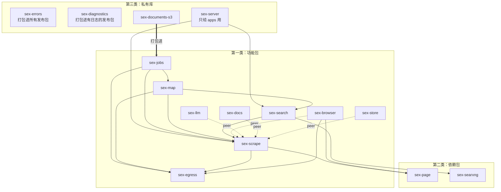
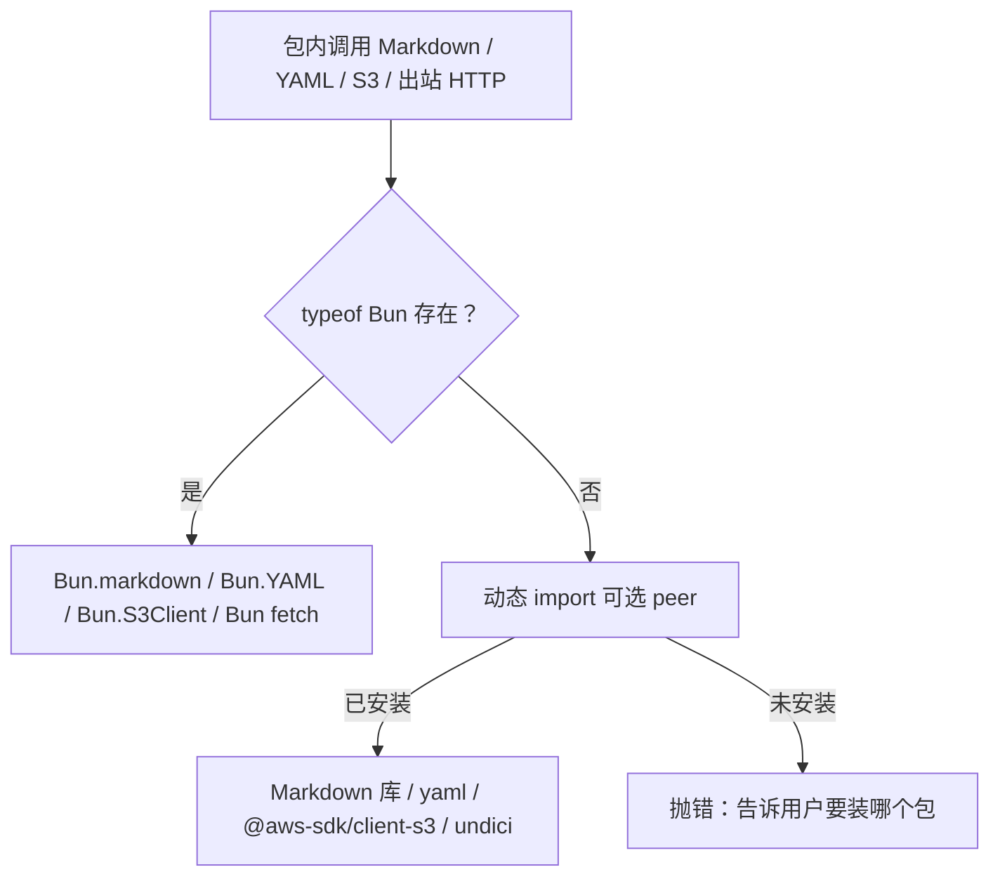
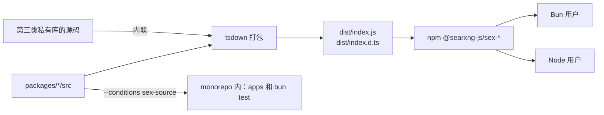

# 仓库架构：packages 与 apps

讨论和进度在 issue #94，本文与其正文保持一致。

## 目标

把仓库拆成可单独安装的包，让外部项目在 Node 或 Bun 上只引入 sex 的某几项能力。

- `packages/*`：库。发布到 npm 的用 scope `@searxng-js`，包名 `@searxng-js/sex-<name>`。
- `apps/sex`、`apps/sex-lite`：两个产品，私有，只跑在 Bun 上。它们只做组装：读 `SEX_*` 配置、拼出 `Engine`、注册路由和 MCP 工具、CLI、把 SearXNG / Lightpanda / here-docs 嵌进单文件二进制。

## 包的三类

### 第一类：功能包

用户为了这个功能而安装它。

**独立功能**

| 包 | 装它是为了 | 依赖 |
|---|---|---|
| `sex-scrape` | 抓一个 URL，得到 Markdown、HTML、links 等（Firecrawl 的 scrape） | `sex-egress`、`sex-page`；p-limit、zod |
| `sex-search` | 用 SearXNG 搜索，可以顺带抓取结果 | `sex-scrape`、`sex-searxng`；p-limit、zod |
| `sex-map` | 找出一个站点的 URL（sitemap、页面链接、搜索） | `sex-scrape`、`sex-search`、`sex-egress`；zod |
| `sex-jobs` | crawl、batch scrape、extract 任务，文档存文件或 S3 | `sex-scrape`、`sex-map`、`sex-egress`；zod。Node 上用 S3 需装可选 peer `@aws-sdk/client-s3` |
| `sex-egress` | SSRF 安全的出站请求：`EgressPolicy`、`safeFetch` | ipaddr.js。Node 上请求走可选 peer `undici` |

**`sex-scrape` 的能力插件**

装上后传给 `sex-scrape`，让抓取多一种能力。对 `sex-scrape` 是 peer 依赖，保证全程只有一份。

| 包 | 装它是为了 | 依赖 |
|---|---|---|
| `sex-browser` | 用浏览器渲染页面（Lightpanda 或 CDP），含 adblock、`EgressProxy` | peer `sex-scrape`；`sex-egress`、`sex-page`；puppeteer-core |
| `sex-llm` | LLM 格式（json、summary、问答、highlights）和注入防护；`sex-jobs` 的 extract 也用它 | peer `sex-scrape`；xsai、ajv |
| `sex-docs` | PDF、Office 文档、图片的转换和 OCR | peer `sex-scrape`；here-docs。Node 上能否用取决于 here-docs |
| `sex-store` | 页面缓存（`maxAge`）和 change tracking | peer `sex-scrape`；diff |

### 第二类：依赖包

会发布，用户会装上，但不是冲着它装的，是功能包把它带进来的。

| 包 | 被谁带进来 | 内容 | 依赖 |
|---|---|---|---|
| `sex-page` | `sex-scrape`、`sex-browser` | HTML 和 PDF 提取：Defuddle、page-script、unpdf、extract worker 池、Markdown 转 HTML | defuddle、linkedom、unpdf。Node 上 Markdown 库是可选 peer |
| `sex-searxng` | `sex-search` | 连接外部 SearXNG，或作为子进程托管一个 | @searxng-js/searxng。Node 上 `yaml` 是可选 peer |

### 第三类：私有库

不发布。构建时打包进用到它的地方：第一类、第二类包，或者 apps。打包进发布包的私有库要能在 Node 上跑；只给 apps 用的只需要支持 Bun。

| 包 | 打包进 | 内容 |
|---|---|---|
| `sex-errors` | 所有发布包 | `AppError`、错误目录、`badRequest` 等辅助函数。类上带 `Symbol.for` 标记，见下方「错误」 |
| `sex-deadline` | `sex-scrape`、`sex-map`、`sex-browser`、`sex-llm`、`sex-docs` | `Deadline`：一次操作剩下的时间加调用方的取消。包的边界只传 `signal` 和可选的 `deadlineAt`，收到的包用它重建自己的 `Deadline` |
| `sex-diagnostics` | 除 `sex-egress` 外的所有发布包 | 日志通道名单 `CHANNELS`、控制台形状的 `diagnostics(name)`、`subscribeAll`，见下方「日志」 |
| `sex-documents-s3` | `sex-jobs` | S3 胶水：Bun 上用 `Bun.S3Client`，Node 上动态 import `@aws-sdk/client-s3`，没装就报错 |
| `sex-server` | `apps/sex`、`apps/sex-lite` | 两个 app 共用的脚手架：Hono + oRPC、`/v2/scrape` 和 `/v2/search` 路由、`web_fetch` / `web_search` MCP 工具、`BaseEngine`、citty 的公共 flag。只跑在 Bun 上，直接用 `Bun.serve` |

### 不属于三类

- `sex-testing`：fixture 站点、mock SearXNG、mock LLM、counting proxy。只给测试用。
- bunqueue 实现的 `TaskQueue`：放在 `apps/sex/src`，只给 apps 用。等有外部的 Bun 项目要跑持久化任务，再提成功能包。

### 依赖图

实线是普通依赖，虚线是 peer 依赖，粗线是打包进去。



## 规则

### 代码

1. **库不读配置。** 每个包只接自己的 options。`SEX_*` 环境变量和 CLI flag 只在 apps 里解析。
2. **接口由使用方定义。** 比如 `ScrapeBrowser` 在 `sex-scrape` 里，`TaskQueue`、`DocumentLog` 在 `sex-jobs` 里。实现放在别的包，不会出现所有包都依赖的底座包。
3. **依赖通过普通对象传入。** 不用 DI 容器，不用 class 装饰器，不用 Effect。上下文参数写成小接口的交集，比如 `scrapeUrl(ctx: Fetcher & Extractor & Partial<Browser>)`，少传一项就是编译错误。
4. **生命周期用 `AsyncDisposable`。** 有资源的对象实现 `Symbol.asyncDispose`，组装处用 `AsyncDisposableStack` 逆序释放。
5. **schema 归各自的包。** 每个包导出自己输入、输出的 zod schema 和类型。用到别人的 schema，就依赖那个包。

### 错误

参照 AI SDK：`AppError` 带 `Symbol.for("searxng-js.sex.error")` 标记，`AppError.isInstance(e)` 检查标记。`Symbol.for` 走全局注册表，每个包各打包一份类也能互相识别（Node 和 Bun 已验证）。

- 跨包判断错误只用 `AppError.isInstance`，不用 `instanceof`。
- `status`、`retryable`、`blocked`、`fallback` 在构造时写到实例上。判断时读实例字段，不按 `code` 回查目录，因为不同包可能打包了不同版本的目录。
- 标记名和实例字段的形状是跨版本契约。做不兼容的改动时换一个标记名。

### 超时和取消

- 包的边界只传 `AbortSignal`。要把时间交给不认 signal 的 API（puppeteer 的 `timeout`、docs 的“剩余时间的 90%”）时，再传一个 `deadlineAt` 数字。
- 包的入口用 `AbortSignal.any([signal, AbortSignal.timeout(ms)])` 合并自己的超时。
- 超时还是取消，看 `signal.reason`：`TimeoutError` 是超时，`AbortError` 是取消。每个包翻译成自己的错误码。
- `sex-scrape` 内部要不要留一个 `Deadline` 小工具由它决定，不导出。

### 日志

包不输出日志，也没有 `logger` 选项；日志走 `node:diagnostics_channel`（Bun 和 Node 都有）。原因：模块级的日志级别打包成多份后，app 设的级别传不到各个包；通道按名字取，打包成多份也还是同一个通道。

- 每个发布包一个通道，名字 `searxng-js:sex:<包名去掉 sex- 前缀>`，例如 `searxng-js:sex:scrape`。每个包只在自己的通道上发布。`sex-egress` 目前没有日志，没有通道。
- 消息是 `{ level, msg, fields? }`：`level` 是 `"debug" | "info" | "warn" | "error"`，`msg` 是字符串，`fields` 是普通对象，没有字段时不带这个键。**通道名和消息形状是公开契约**，改动要按破坏性变更处理；每个发布包的 README 有「Diagnostics」一节写明通道名、形状和订阅示例。
- 私有库 `sex-diagnostics` 打包进各包：`CHANNELS` 是通道名的唯一名单；`diagnostics(name)` 返回绑在一个通道上的控制台形状对象（`debug` / `info` / `warn` / `error`），名字只能取自名单；通道没有订阅者时（先查 `hasSubscribers`）什么都不做，不构造消息。每个包的 `src/log.ts` 是 `export const log = diagnostics("searxng-js:sex:<包名>")`。
- app 一侧：`sex-server` 的 `log.ts` 在加载时对名单里的所有通道调 `subscribeAll`，把每条消息按原来的格式写到 stderr，级别门槛仍是 `SEX_LOG_LEVEL` / `--log-level`，所以 CLI 和服务的输出不变。日志仍然只写 stderr。
- 测试：`sex-diagnostics` 的测试检查每个发布包的源码里出现的通道名都在名单里、而且是它自己的，名单里的每个通道都有对应的发布包；检查日志调用的包测试直接订阅通道。

### Bun 和 Node

| 情况 | 做法 | 例子 |
|---|---|---|
| 两边都有的 `node:` 内置模块 | 直接用，不设接口 | `node:sqlite`、`node:zlib` 的 zstd、`node:child_process`、`node:fs`、`node:timers/promises` |
| 只有 Bun 有内置实现 | `typeof Bun` 分支：Bun 用内置 API，Node 动态 import 可选 peer，没装就报错 | Markdown、YAML、S3、出站 HTTP（`undici`） |
| 部署选择 | 接口加单独实现 | `TaskQueue` |

包里不能静态 import `bun:*` 或 `"bun"`。

出站 HTTP（`sex-egress` 的 `sendRequest`）：Bun 分支不变（`fetch` 带 `proxy` 和 `tls` 选项，固定地址靠把 URL 改写成已验证的 IP）。Node 分支一律走 `undici`（动态 import，可选 peer，没装就抛 `NOT_SUPPORTED` 并写明 `undici`），不再手写 `node:http(s)`：

- 固定地址：保留原 URL，dispatcher 的 `connect.lookup` 只回答已验证的地址，所以 `Host`、SNI 和证书检查用的都是真实域名。
- `skipTlsVerification` 和 `ca` 放进 connect 选项。
- 代理：`ProxyAgent`，语义和 Bun 一致：不固定地址，先用 `requireResolvable` 解析并检查主机，丢掉调用方设的 `Proxy-Authorization` 和 `Proxy-Connection`，用代理 URL 里的凭据。http 目标走转发（绝对地址请求），https 目标走 CONNECT 隧道。Node 上不再因为设了代理而报 `CONFIG_INVALID`。
- 不留连接：每个请求一个 dispatcher，响应体读完、取消或出错（或信号中止）时关闭。没有做缓存池，因为 `safeFetch` 每一跳本来就要换固定的地址，复用连接的机会几乎没有。
- `networkError` 从 undici 放在 `err.cause` 上的 `code` 取错误码。
- 调用方设的 `Accept-Encoding: gzip` 现在会被解码（原来的 `node:http(s)` 路径不解码）。



### 依赖

Bun 用户不下载任何只给 Node 用的依赖。

- Node 专用的库只写进 `peerDependencies`，并在 `peerDependenciesMeta` 里标 optional。`bun install` 和 `npm install` 都不会自动装可选 peer（已验证）。
- 可选 peer 声明在含有这段 import 的发布包上。私有胶水打包进哪个包，就声明在哪个包上，否则 pnpm 解析不到。
- `.d.ts` 里不出现这些库的类型。
- 每个包的 README 写明 Node 上要多装什么、Node 上用不了什么。

## 构建和发布

- 每个发布包都打包，Bun 用户也一样，只发一份 `dist/index.js` 和 `dist/index.d.ts`。`files` 只有 `dist` 和 `README.md`。
- `exports`：

```json
{
  ".": {
    "sex-source": "./src/index.ts",
    "types": "./dist/index.d.ts",
    "default": "./dist/index.js"
  }
}
```

- `sex-source` 只在 monorepo 内部用。dev、test 和 apps 的二进制构建都带 `--conditions sex-source`，tsconfig 的 `customConditions` 也加上。`bun` 运行、`bun test`、`bun build` 都认这个条件，Node 不认（已验证）。
- tsdown 打包：私有库一律内联，发布包和 peer 依赖一律外部。
- changesets 管理版本，各包独立版本号，GitHub Actions 带 provenance 发布。Node 最低 24。



## 测试

- 包的测试用 `node:test` 和 `node:assert` 写，`bun test` 和 `node --test` 都能跑（已验证）。
- 测试按包名 import。Bun 带 `sex-source` 跑源码，Node 跑要发布的 `dist`。
- 测试文件只用可擦除的 TS 语法，因为 Node 只剥离类型，不支持 enum 和构造函数参数属性。
- apps、只给 apps 用的私有库（`sex-server`）和跨包集成测试保持 `bun:test`，只在 Bun 上跑。
- CI 两个 job：Bun 跑 `bun test --conditions sex-source`；Node 24 先 `bun run build:packages`，再对发布包和打包进发布包的私有库的测试跑 `node --test`。

## 落地顺序

自底向上：先第三类，再第二类，最后第一类。每步一个 PR，Bun 和 Node 的测试都要通过，同一个 PR 里更新 CLAUDE.md 的 Layout 和 README 的仓库结构表。

- [x] 1. **骨架**：`apps/` 目录、tsdown、changesets、`sex-source` 条件、CI 的 Bun 和 Node 两个 job、Dockerfile 路径。
- [x] 2. **第三类 `sex-errors`**：`Symbol.for` 标记和 `isInstance`；11 处跨包的 `instanceof AppError` 换掉。（`log` 改成 `logger` 选项随各包抽出时做，不在本步。）
- [x] 3. **`sex-egress`**：边界改为 `signal`。它不依赖别的包，先做。
- [x] 4. **第二类 `sex-page`、`sex-searxng`**：Markdown、YAML 按运行时分支。
- [x] 5. **`sex-scrape`、`sex-search`、`sex-server`**：完成后 `apps/sex-lite` 完全基于新包，删除 `packages/core`。
- [x] 6. **能力插件 `sex-browser`、`sex-llm`、`sex-docs`、`sex-store`**：SQLite、zstd 换成 `node:` 内置，换之前先测 SQLite 在 Bun 上的性能。
- [x] 7. **`sex-map`、`sex-jobs`、第三类 `sex-documents-s3`**：bunqueue 队列移进 `apps/sex/src`。完成后 `apps/sex` 迁移完毕。
- [ ] 8. **首次发布到 npm。**

## 风险和待确认

- **SQLite 性能**：jobs 存储从 `bun:sqlite` 换成 `node:sqlite` 后，在 Bun 上可能变慢。如果明显变慢，jobs 的 SQLite 也改成按运行时分支。步骤 6 先测了页面缓存（`sex-store`）：同一个表结构，Bun 1.4.3 上 5000 次 `put`（删旧行、zstd 压缩一个 9 KB 页面、插入）和 5000 次 `get`（查询、更新 `used_at`、解压），两轮：`bun:sqlite` 约 48–53 µs / 次，`node:sqlite` 约 44–54 µs（put）和 48–61 µs（get）。差别在噪声里，前提是每个连接只 `prepare` 一次（`node:sqlite` 每次都 `prepare` 要慢约一半，约 78 µs / 65–75 µs；`bun:sqlite` 的 `query()` 自带缓存）。所以 `sex-store` 直接用 `node:sqlite`，带一个按连接缓存语句的小封装。jobs 存储的写入量和事务更多，步骤 7 用同样的方法测了：Bun 1.4.3，同一个 `SqliteJobStore`（两个版本只差 SQLite 的调用），20000 个 URL 的热路径，三轮：`schedule`（每次 100 个候选，含 `seen` 和 `outbox` 写入）`bun:sqlite` 约 19–22 µs / URL，`node:sqlite` 约 22–25 µs；`pushDocument`（查 job、领取、插入索引、`completed + 1`，文档字节写内存日志）68–70 µs 对 71–79 µs；`settle` 49–52 µs 对 49–55 µs；读一页 100 个文档的索引 0.25–0.27 ms 对 0.23–0.34 ms。慢不超过 1.1 倍，在 1.5 倍以内，所以 `sex-jobs` 直接用 `node:sqlite`（同样每个连接只 `prepare` 一次，见 `packages/jobs/src/db.ts`）。`bun:sqlite` 写出的 `jobs.sqlite` 用新代码打开、再用旧代码打开，都读得出（互读验证过）。
- **类型内联**（第 2 步已确认，可行）：发布包引用私有库（`sex-errors`）时，tsdown 把 JS 和 `.d.ts` 里的 `AppError` 等都内联，dist 里没有私有包名。需要的配置：
  - `deps: { alwaysBundle: [/^@searxng-js\/sex-errors/] }`：私有库在 `dependencies` 里（`workspace:*`），默认会被当外部依赖，必须强制内联。
  - `inputOptions.resolve.conditionNames: ["sex-source", "import", "default"]`：私有库没有 dist 时也能从 `src` 解析。
  - `tsconfig: "../tsconfig.build.json"`：tsgo 生成 `.d.ts` 时，rolldown-plugin-dts 以 tsconfig 所在目录为根去找每个源文件的声明，所以 tsconfig 必须在包含所有被内联的包的目录里（`packages/tsconfig.build.json`，include `*/src`），不能用发布包自己目录里的。
  - `fixedExtension: false`，输出 `dist/index.js` 和 `dist/index.d.ts`，不是 `.mjs` / `.d.mts`；`format: "esm"`、`dts: true`。
  - 私有库自己也有 `tsdown.config.ts`，并设 `"sexNodeTests": true`：Node 测试按包名 import，Node 读 dist，所以 `build:packages` 也构建它。
- **日志**：已定，见「日志」一节。

## 要改的现有约定

- CLAUDE.md「新错误码先进目录，按目录判断、不看 AppError 自己的 403」改为：判断读实例字段，跨包用 `isInstance`。
- CLAUDE.md「步骤里不许建 `AbortSignal.timeout` / `AbortSignal.any`，一律用 `Deadline`」改为：边界传 `signal` 和可选的 `deadlineAt`，包的入口可以合并自己的超时。
- CLAUDE.md「Markdown 只用 `Bun.markdown`」只在 Bun 分支成立，Node 分支用库。

## 当前进度

步骤 1–7 做完了：`packages/core` 已删，`apps/sex` 和 `apps/sex-lite` 都只做组装，所有库在 `packages/` 里。还剩步骤 8（首次发布到 npm）。每步的细节在对应的提交信息里，和本文不同的地方如下。

- `sex-deadline`（步骤 6 加的私有库）：`sex-browser`、`sex-llm`、`sex-docs` 要用同一个 `Deadline`，又不能从 peer `sex-scrape` 拿，所以抽成私有库打包进去。步骤 7 里 `sex-map` 也打包它（`mapSite` 内部保留一个 `Deadline`，错误码仍是 `TIMEOUT`；`sitemapUrls`、`fetchRobots` 在边界上收 `CallTime`）。`sex-jobs` 不用：webhook 的一次投递和 crawl 取 robots.txt 在入口处用 `AbortSignal.timeout`，extract 给 LLM 调用传 `{ signal }`。
- `sex-jobs` 的 extract 不依赖 `sex-llm`：它要的 LLM 能力是 `JobsLlm` 接口（`sex-llm` 的 `Llm` 满足，为此 `Llm` 多了 `schemaErrors` 和 `relevanceFieldDescription`），网页搜索是 `JobsContext.search`。所以 `sex-jobs` 的依赖是 `sex-scrape`、`sex-map`、`sex-egress`，和本文的表一致，不需要 `sex-search`。
- `sex-documents-s3` 里 `S3DocumentLog` 不 import `sex-jobs` 的 `DocumentLog`（接口在使用方，会成环），按结构兼容。文档对象名从 `Bun.randomUUIDv7()` 改成 `crypto.randomUUID()`，不再按写入时间排序（没有代码依赖过列表顺序）；`sex-jobs` 也导出 `S3DocumentLog` 和 `openS3`，Node 用户可以自己传端点和凭据。读到对象末尾之外的区间现在两个客户端都返回空（`Bun.S3Client` 原来会抛 `InvalidRange`）。
- 任务队列：`MemoryTaskQueue` 在 `sex-jobs` 里（之前没有），规则和 bunqueue 那份一样（无 lane 的任务先走、lane 轮流、上限、冷却、延迟），但进程结束任务就没了，也没有重新投递；bunqueue 的 `BunqueueTaskQueue` 在 `apps/sex/src/engine/jobs/queue.ts`。
- SQLite：jobs 存储用 `node:sqlite`（数字见上面的风险一条），旧的 `jobs.sqlite` 原样可用。
- 测试：`packages/map`、`packages/jobs`、`packages/documents-s3` 的测试是 `node:test`，Bun 和 Node（对 dist）都跑；要整个 `Engine`、`Bun.serve` 或 bunqueue 的任务测试（`scheduling`、`settlement`、`dead-letter`、`webhook`、`store-contract`、`durability`、`batch-*`、`crawl-semantics`、`robots-rfc`、`map-hardening` 等）留在 `apps/sex/test`，用 `bun:test`。
- 日志：`logger` 选项和各包重复的 `Logger` 接口都删了，改用 `sex-diagnostics`（私有库，打包进 10 个发布包）的 `node:diagnostics_channel` 通道；`sex-server` 的 `log.ts` 订阅所有通道写 stderr，输出不变。
- 分支 `wip/package-split-v1` 上有一版按旧方案做的尝试（公开的 `sex-kit`、`sex-schemas`），只供参考 `apps/` 搬迁等机械步骤，不按它的包划分。
